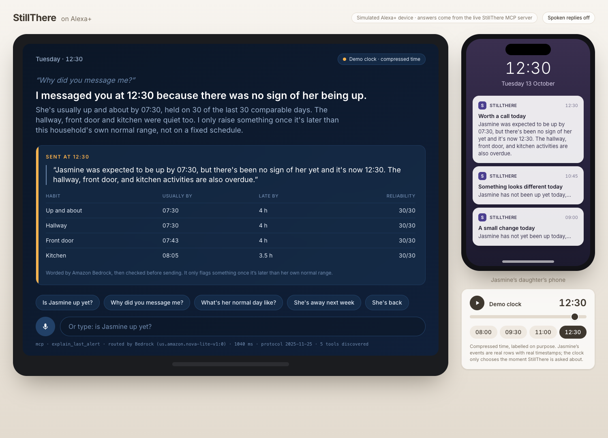
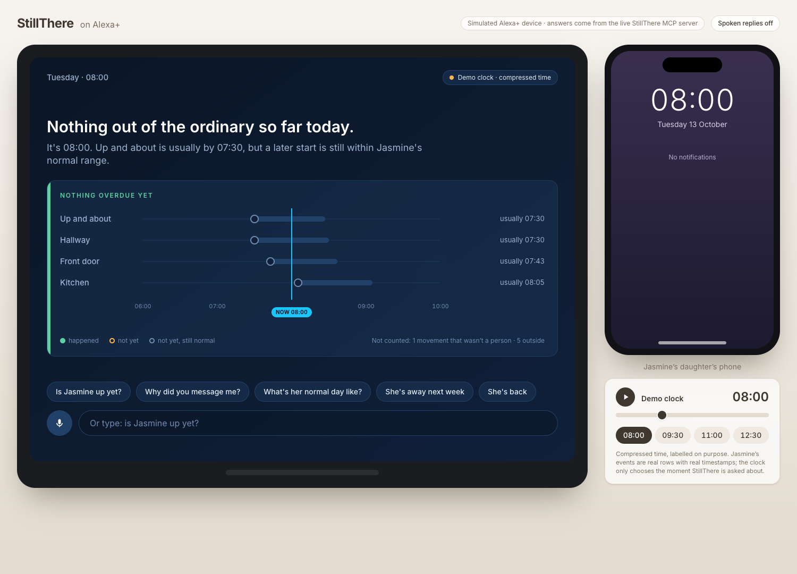
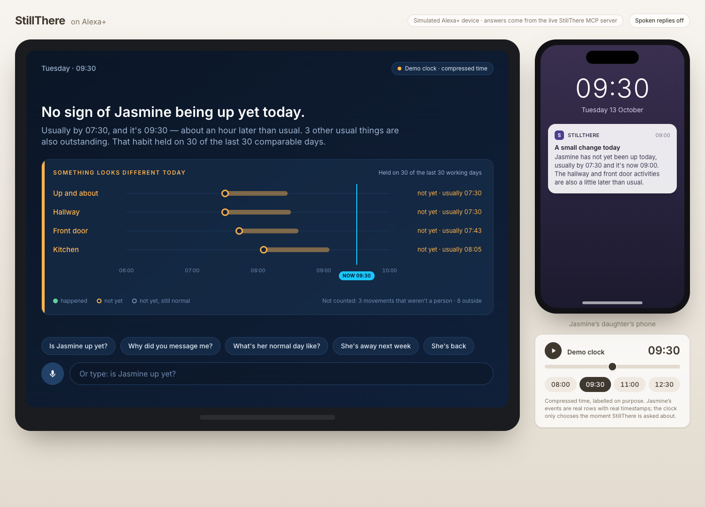
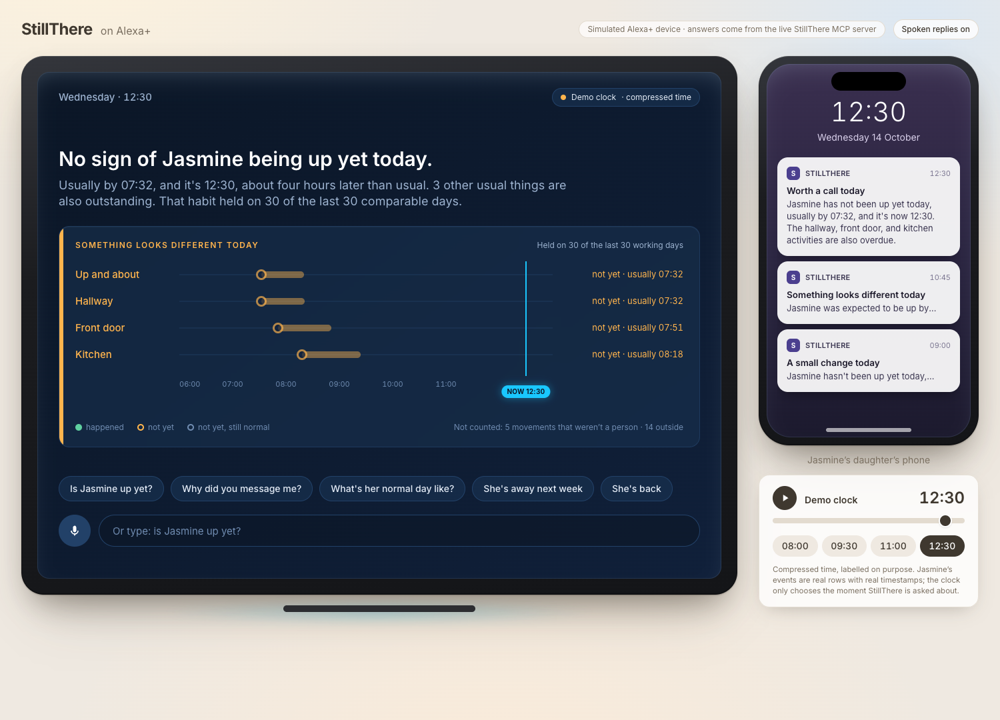
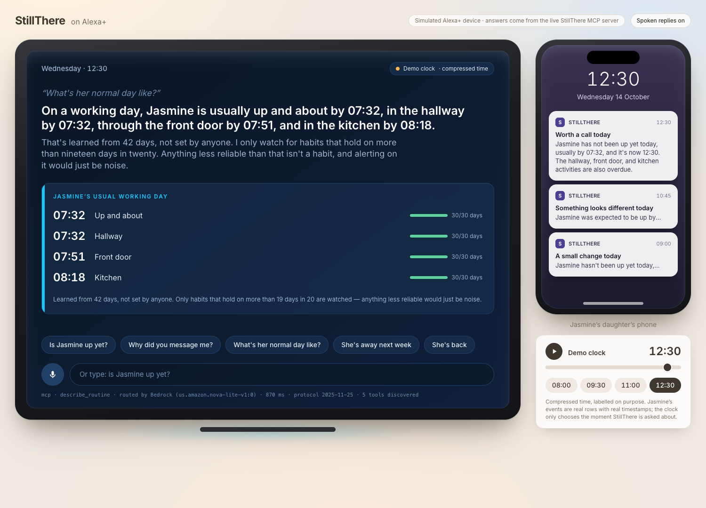
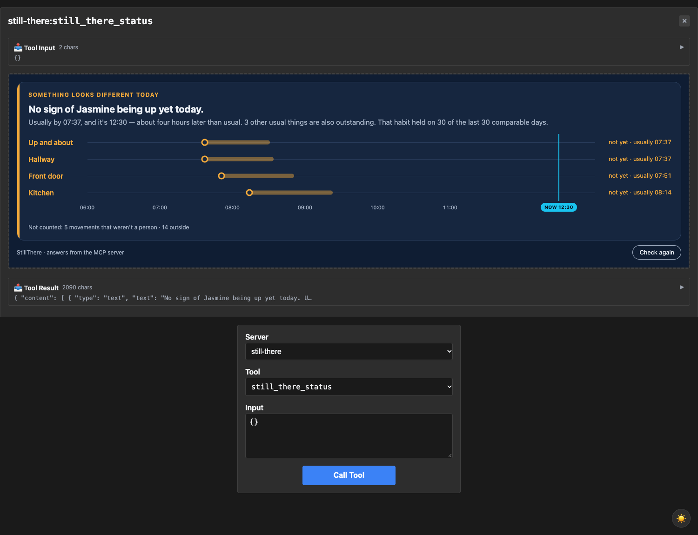

# StillThere

**Ask Alexa+ how your mum's morning went, and get told when it didn't happen.**

StillThere learns an older person's daily rhythm and notices the activity that
**didn't** happen. Then it explains itself, out loud, when the family asks why.

Built for the Alexa+ track of the Build, Ship, Shape: Amazon Developer Hackathon.

| | |
|---|---|
| **Try it** | **https://stillthere.ogbes.com** (access code in the Devpost testing instructions) |
| **MCP endpoint** | `https://eop88u898f.execute-api.us-east-1.amazonaws.com/mcp` |
| **Protocol** | MCP `2025-11-25`, Streamable HTTP, 5 tools |
| **Source** | MIT. Everything here, including the infrastructure. |



## The idea

A camera or a contact sensor already records the shape of someone's day: door opened
at 08:10, movement in the hallway, someone in the kitchen by half past. Normally those
events exist to tell you a stranger is outside. StillThere uses them backwards.

It spends a couple of weeks learning that Jasmine, 82, is up before half seven, out for
the paper by quarter to eight, and in the kitchen by just gone eight. Then one Tuesday
none of that happens, and her daughter gets a message at work: *no sign of Jasmine
being up yet today, usually by 07:30, and it's now 09:00.* Not an alarm. A nudge, with
its reasoning attached.

Then she can just ask the Echo in her kitchen.

> **"Alexa, why did you message me about Mum?"**
>
> "I messaged you at 12:30 because there was no sign of her being up. She's usually up
> and about by 07:30, held on 30 of the last 30 comparable days. The hallway, front
> door and kitchen were quiet too. I only raise something once it's later than this
> household's own normal range, not on a fixed schedule."

That last sentence is the product. Monitoring systems normally cannot tell you why they
contacted you, because the reasoning existed only as long as the alert took to send.

## Why this belongs on Alexa+

Three reasons, and the third is the one that matters.

**Checking in is a question, not an app.** Nobody opens a dashboard to find out their
mother is fine. They wonder aloud in the kitchen. The natural shape of this product is
a question asked into the room, which is what Alexa+ is for, and which an app icon on
a phone will never be.

**The hard part is the explaining, and that is exactly what an assistant is good at.**
A push notification gets about eleven words. A conversation can carry the reasoning:
what was expected, when, how reliably it normally happens, and why today crossed a
line. Families stop trusting alerts they cannot interrogate.

**The person who needs reassuring is the one least able to go and get it.** A daughter
at work, a son in another country. Asking is free. Opening an app, remembering a
password and reading a chart is not, and so it does not happen daily, which is
precisely the frequency at which this kind of monitoring is worth anything.

## Try it

The link above opens a simulated Alexa+ device. Everything it says comes from the live
MCP server over the public internet; nothing on the page is scripted.

1. **Enter the access code** from the Devpost testing instructions. It gates the API,
   not just the page, and it fails closed.
2. **Move the demo clock** (bottom right: 08:00 · 09:30 · 11:00 · 12:30). Watch the
   screen change state and the daughter's phone fill up with the messages that were
   actually sent today. These moved the time of day only. It is still really today.
3. **Tap a suggested question**, or press the microphone and ask in your own words.
   Bedrock picks the tool; the answer is the tool's own text.
4. Try **"she's away next week"**, then **"she's back"**. Those write to the live
   household and change what the other answers say.

**Use Chrome** if you want to talk to it. Speech recognition in the browser is
Chrome-only. Typing works everywhere, and spoken replies can be switched off top right.

### The three states, in order

| 08:00, nothing is wrong yet | 09:30, the first nudge | 12:30, worth a call |
|---|---|---|
|  |  |  |

At 08:00 Jasmine's usual 07:30 has already passed, and the screen says so: *a later
start is still within her normal range*. Saying "nothing is overdue" there would be
true and useless. Severity escalates low → medium → high as the morning goes on, and
the phone stacks each message as it is sent.

Asking **"what's her normal day like?"** shows the learned routine and how dependable
each habit is, which is the honest answer to *what do you actually watch for*:



## The MCP server

StillThere is an MCP server first. The web app is one client; your assistant can be
another.

Five tools, written to be asked rather than read. Every result carries both a sentence
(for speech) and `structuredContent` (for a screen), so one server serves a voice-only
assistant and a display device without either compromising.

| Tool | Asked as | Writes? |
|---|---|---|
| `still_there_status` | "is Mum up yet", "is everything alright", "any news" | no |
| `explain_last_alert` | "why did you message me", "what was that about" | no |
| `describe_routine` | "what does a normal day look like for her" | no |
| `pause_monitoring` | "she's away this week" (asks how many days if unclear) | yes |
| `resume_monitoring` | "she's back", "start watching again" | yes |

No tool returns raw events, device identifiers or images.

### Connect your own client

```json
{
  "mcpServers": {
    "still-there": {
      "url": "https://eop88u898f.execute-api.us-east-1.amazonaws.com/mcp",
      "headers": { "Authorization": "Bearer <access code>" }
    }
  }
}
```

Or by hand:

```bash
curl -s https://eop88u898f.execute-api.us-east-1.amazonaws.com/mcp \
  -H "Authorization: Bearer $STILL_THERE_ACCESS_CODE" \
  -H 'Content-Type: application/json' -H 'Accept: application/json, text/event-stream' \
  -d '{"jsonrpc":"2.0","id":1,"method":"tools/list"}'
```

The server advertises protocol `2025-11-25` and runs in a single Lambda: the SDK's
`McpServer` behind a stateless Streamable HTTP transport, one request per invocation.

### Checked against the Alexa+ MCP requirements

Alexa+'s own MCP Toolkit and simulator are partner-only for now, and the hackathon
FAQ confirms entrants cannot get access. So we did the step Amazon recommends before
the simulator: validating the server in isolation with the standard
[MCP Inspector](https://github.com/modelcontextprotocol/inspector). Then we checked
it against the published requirements one by one:

| Alexa+ requirement | StillThere |
|---|---|
| MCP `2025-11-25` | ✅ negotiated by the SDK |
| Streamable HTTP, not legacy SSE | ✅ JSON responses over Streamable HTTP |
| Reachable at a remote HTTPS URL | ✅ API Gateway, TLS 1.2+ |
| `401` for unauthenticated requests, **without** `WWW-Authenticate` | ✅ bare 401; the body says how to authenticate |
| Bearer token in the `Authorization` header, never the query string | ✅ |
| Round trip under 500 ms | ✅ warm: 20–85 ms in the function, ~0.33 s end to end from the UK, half of it TLS setup. ⚠️ A cold start is ~1.4 s. |
| OAuth 2.1 + PKCE account linking, PRM document | ❌ a shared access code instead. See *Not built yet*. |

```bash
npx @modelcontextprotocol/inspector@2.10.1 --cli https://eop88u898f.execute-api.us-east-1.amazonaws.com/mcp \
  --transport http --header "Authorization: Bearer $STILL_THERE_ACCESS_CODE" --method tools/list
```

The latency figure took one change: the six weeks of history behind every status
answer cannot change during the day, so a warm container keeps it for ten minutes
instead of re-reading roughly two thousand rows per question.

### It ships its own screen (MCP Apps)

Every tool is linked to `ui://still-there/today.html`, an
[MCP Apps](https://apps.extensions.modelcontextprotocol.io/) view, so a host that
supports the extension draws the answer instead of only reading it out. Alexa+
supports MCP Apps on Echo Show, so this is what a StillThere answer would look like
there: today's habits on a timeline, the learned routine, or the message that was sent
and why.



*Rendered by the official reference host from the
[ext-apps repository](https://github.com/modelcontextprotocol/ext-apps) (v1.7.5), in
its sandboxed iframe, against our server. "Check again" calls `still_there_status`
back through the host. The view never talks to the server directly.*

How it's built:

- **One self-contained HTML file.** The sandbox has no network access, so script and
  styles are inlined. The CSP declares no domains. `scripts/build-mcp-app.mjs` bundles
  `mcp-app/` with esbuild into a module the Lambda imports, so there is nothing to
  deploy alongside it.
- **Rendering is a pure function** (`src/mcp/app-view.ts`): structuredContent in, HTML
  out, every value escaped, unit tested in Node. A result the view doesn't recognise
  falls back to the spoken text instead of going blank.
- **Follows the host's light or dark theme**, through the official `App` client.
- **263 KiB.** The first build was 520 KiB, about 300 KiB of it Zod's error messages in
  fifty languages. The build drops that one re-export; validation is untouched.

To see it yourself:

```bash
npm run build:lambda
AWS_PROFILE=… node dist/tools/local-mcp.mjs --demo-minute 750   # 127.0.0.1 only, no auth
# then, in ext-apps/examples/basic-host: npm install && npm start → http://localhost:8080
```

Our own simulated Echo Show draws its cards with React rather than hosting this view,
because a strict page CSP and an MCP Apps sandbox need separate origins. Making the
simulated device a full MCP Apps host is the obvious next step.

### `explain_last_alert` is the interesting one

Because the message and the findings behind it are stored, the explanation is
**recalled, not reconstructed**. The reply quotes the exact words the family received,
the habits that were missed, when each was expected, and how consistent each had been.
A system that regenerated that explanation could drift from what it actually sent,
which is the one thing an audit trail must not do.

## What is real and what is simulated

Stated up front, because it is the first thing anyone evaluating this should know, and
better said by us than discovered by a reviewer.

**Real, running on AWS right now:**

- The MCP server, on the public internet, speaking a current revision of the protocol.
- Tool selection by Amazon Bedrock (Nova Lite) from the live `tools/list` output.
- The learned baseline, the assessment, the notification policy and the stored audit
  trail, over thousands of events in DynamoDB.
- The alert wording, written by Bedrock and then checked before sending.
- CloudFront, S3, API Gateway, eight Lambdas, KMS, Secrets Manager, EventBridge
  Scheduler (every 15 minutes, plus a nightly demo reset), SNS, four alarms. All in
  Terraform.

**Simulated, deliberately and visibly:**

- **The Alexa+ device.** It is a web page styled as an Echo Show, labelled as such on
  screen. Alexa+ cannot yet be extended with a third-party MCP server by a developer
  outside the programme, so the client is ours. The server behind it is not a mock,
  which is the half that was worth building properly.
- **The household's events.** Jasmine is a synthetic persona with 42 days of generated
  history. See below. Every night at 00:05 London time a scheduled job
  (`src/handlers/demo-reset.ts`) rebuilds her six weeks and today's missing morning,
  then runs the *deployed* assessment at 09:00, 10:45 and 12:30, so the three messages
  are produced the real way (Bedrock, validation, SNS), and the demo tells the same
  story whichever day it is opened. It refuses to run unless the deployment is marked
  as a demo.
- **The clock, within today.** The demo clock moves the *time of day* and nothing else.
  The events carry real timestamps and the date is really today; `assess` is asked
  about a chosen moment rather than made to wait for one.

### Why the events are synthetic

**No Ring account has ever been linked to this app, and no physical device was used.**
Not a shortcut taken for convenience. Ring private apps connect real accounts, and
[each connected account needs an active Ring Protect Plan or trial](https://developer.amazon.com/docs/ring/developer-faq.html)
for device access. We had neither the hardware nor the subscription, and the Playground,
as far as we could determine, does not deliver events to a registered webhook URL, so
it could not stand in as an event source.

So the events are ours. `scripts/send-test-webhook.mjs` builds a payload in Ring's
documented webhook v1.1 shape, signs it with the real HMAC key issued by the Ring
Developer Portal, and posts it at the deployed endpoint over the public internet.

What that genuinely exercises:

| Exercised for real | How |
|---|---|
| HMAC-SHA256 signature verification | Valid signature accepted, tampered body rejected with 401 |
| The v1.1 JSON:API envelope | Parsed from `data.type`, `data.attributes.source`, `data.attributes.timestamp` |
| The event vocabulary | `motion_detected`, `button_press`, `contact_sensor_faulted`, `device_offline`, `app_integration_removed` |
| Deduplication | Replayed `meta.request_id` returns `duplicate` |
| Everything downstream | Storage, baseline learning, assessment, Bedrock narration, SNS delivery, erasure |
| Client credentials | Verified against `oauth.ring.com`, which returns `invalid_grant` rather than `invalid_client` |

**The one untested assumption is that the real bytes match the documented shape.**
Everything downstream of the parser is proven; the parser is written from the
specification rather than from a captured delivery. Which is why the adapter is strict
rather than tolerant: an unrecognised payload returns `invalid` listing the keys it did
contain, so the first real delivery reports precisely what differs instead of silently
coercing something plausible. An earlier version guessed a flat payload shape and was
wrong about nearly every field name, which is how that lesson was learned.

The event source is a seam, by design. `src/ring/adapter.ts` is the only file that
knows Ring exists; everything below it reasons about `ActivityEvent`. A different
sensor vendor is a new adapter, not a new product.

## Honest positioning: this category exists

Worth stating plainly, because it shapes what is actually new here.

- **Alarm.com Wellness** does essentially this today, commercially: machine learning
  over activity data to learn routines and alert family to changes. It needs a
  professionally fitted sensor kit, a panel, a dealer and a monitoring subscription.
- **Amazon built and then withdrew it.** Alexa Care Hub (2020) became the Alexa
  Together subscription, discontinued in May 2025 and replaced by Alexa Emergency
  Assist, a *reactive* service where someone has to ask for help.
- There is twenty years of academic work on activity-of-daily-living anomaly detection
  behind both.

So the concept is not novel. Four things about this delivery are:

1. **It fills the gap Amazon left, in the place Amazon left it.** Passive routine
   monitoring is precisely what Emergency Assist cannot do, because the whole point is
   the days nobody can ask. Putting it back on Alexa+ puts it where it was.
2. **The alert explains itself, conversationally.** Traditional systems cross a
   threshold and emit "unusual activity detected". Families stop trusting those, then
   stop reading them. Every finding here names the habit, the time it was expected, and
   how consistent it has been, and will answer follow-up questions about it.
3. **The assistant cannot invent the facts.** The model routes and nothing else. See
   below; this is the part most voice integrations get wrong.
4. **Zero new hardware, in principle.** It runs on consumer devices people already own
   rather than an installed kit, a contract and a panel.

## How it works

Two halves. One watches and notices; the other answers questions about what it noticed.

**The watching half**, which runs whether anybody is asking or not:

```
events ──▶ verify HMAC ──▶ classify ──▶ dedupe ──▶ DynamoDB
                               │
                               ├─ activity      → event stream
                               ├─ device status → latest health per device
                               └─ revocation    → erase everything

every 15 min ──▶ learn baseline (42 days, excluding today)
                      │
                      ├─ assess(evaluatedAt) ─┬─ deviation    → notify policy → Bedrock
                      │                       │                 → validate → SNS → family
                      │                       └─ unobservable → maintenance, never family
                      └─ device health
```

**The asking half**: the MCP server, and two clients for it:

```
                      ┌─ /api/assistant ─▶ Bedrock picks a tool ─┐
browser ─▶ CloudFront ─┤   (spoken or typed questions)            ├─▶ MCP ─▶ DynamoDB
 (Echo Show UI)       └─ /api/mcp ──────────────────────────────┘    │
                          (ambient view: no model, no cost)          │
                                                                     │
any MCP client ─▶ POST /mcp  (Authorization: Bearer) ────────────────┘
```

Same origin, so no CORS: `/api/*` is a CloudFront behaviour pointing at API Gateway,
caching disabled. The page itself is S3 behind OAC with a strict CSP and bundled fonts
(no third-party font CDN, so the CSP has no exceptions in it).

### The model routes. It does not narrate the facts.

`/api/assistant` passes the utterance and the live `tools/list` output to Nova Lite and
asks it to pick a tool. The **spoken reply is the MCP tool's own deterministic text**,
not the model's prose. So the assistant can misroute a question, and the worst case is
a correct answer to the wrong question, never a confident invention about someone's
mother.

A keyword router sits behind it and takes over if Bedrock is unavailable, denied or
slow. The feature degrades to a slightly stupider router. It does not go down.

Routing costs one Nova Lite call per spoken question, and the ambient view costs nothing,
because the screen reads MCP directly, so moving the clock is free. That is a cost decision as
much as a correctness one.

### Six design decisions that carry the weight

**Time is an argument, never ambient.** No `Date.now()` anywhere in `src/domain`. Every
function takes the instant it should reason about.

That one constraint pays for itself repeatedly. It is why the test suite replays ninety
days in under a second, why the false-positive budget is measurable at all, and why the
demo can walk through a morning without waiting for one. A system that reads the clock
internally could not be demonstrated in three minutes, which for a project judged on a
three-minute video would have been fatal.

**Not all events are occupancy evidence.** A doorbell facing the street fires on passing
cars and the postman. If exterior motion counted as occupancy, the system would report a
normal morning for a house nobody had got out of bed in, the most dangerous false
negative available. Only interior movement, or a door physically opening, counts.

**And not all interior movement is a person.** Motion is classified `human`, `vehicle`
or `other_motion`, and that distinction does real work, because the cat walks through
the hallway all day. By default only `human` and unclassified motion count as proof of
life. The asymmetry is deliberate: mistaking a pet for the resident means silence on a
day something was wrong, while discounting the resident means one unnecessary phone
call. Only one of those hurts anybody.

A pleasant consequence, found while writing the test for it: a cat cannot open a front
door, so the contact-sensor anchor survives even if motion classification fails
completely. Households with a contact sensor get defence in depth for free.

**A flat battery and an unconscious person produce identical data: silence.** Every
missing-activity finding is checked against device health first. If the camera was
offline, flat, or quietly stale, the finding becomes `unobservable` and routes to
maintenance, never to the family as a welfare alert. This is the single correctness
question in the product.

**Deadlines come from the late edge of what this household actually does.** The 95th
percentile of observed times plus a grace period, rather than a median and a spread
multiplier. Most mornings cluster tightly and then straggle, so a symmetric model gives
a regular household a hair-trigger and an irregular one a deadline that never arrives.

**One message, then only on escalation.** The assessment runs every 15 minutes, and an
early version sent a message, and made a Bedrock call, on every single run of a bad
morning. The family would have had sixteen texts by lunchtime. `src/notify/policy.ts`
now sends once the first time something is wrong today, then only when severity
actually escalates: at most three messages a day, which is exactly what the phone in
the screenshot shows.

**Withdrawing consent erases everything.** When the integration is removed, the tokens,
activity history, learned routine, room assignments and record of past notifications
are all deleted. Not marked for expiry. Deleted. Letting the 90-day TTL handle it
would be defensible and would also mean keeping months of somebody's movements after
they asked us to stop. Expiry is not erasure.

## The false-positive budget

We claim this beats alert fatigue, so the claim carries a number. The suite learns a
baseline, then lives through 60 ordinary days where nothing is wrong, checks in four
times a day, and counts how often the family gets bothered for no reason.

| Household | Unnecessary alerts per 30 days | Anchors learned |
|---|---|---|
| Jasmine (regular routine, and a cat) | **0.00** across 3 seeds | 8 |
| Nosa (no real schedule) | **1.00, 1.00, 1.50** across 3 seeds | 4 |

Nosa's budget is deliberately non-zero, and he is the honest half of the test. His
habits are loose enough that some days genuinely look like nothing happened. The two
cheap ways to make his number zero are to invent structure he does not have, or to widen
tolerances until nothing is ever noticed, so there is a test asserting he still has
anchors, to prove the budget is met by judgement rather than by giving up.

The reliability threshold does the work. An anchor absent on 12% of normal days will
fire on 12% of normal days, which is about three nudges a month for a habit the resident
simply does not always keep. At 0.95 a habit must hold on more than nineteen days in
twenty before we are willing to wake anybody over its absence. For Nosa that means all
his mealtime anchors are correctly discarded: the system can tell you reliably whether
he reached his lounge, and admits it knows nothing dependable about when he eats.

## What an alert is allowed to say

Findings are generated deterministically. Bedrock then rewrites them into something
readable, and **its output is a proposal, not a decision.**

That distinction is the whole design. A language model cannot be tested into never
saying "she may have fallen". Prompting lowers the odds and guarantees nothing. So the
model's text is checked against the same rules the deterministic text already satisfies,
and discarded in favour of that text when it fails. The safety properties therefore
hold regardless of the model, the prompt, or a bad day.

`tests/safety.test.ts` and `tests/narration.test.ts` pin the invariants. Rejected:

- speculation about cause, health or injury: "no kitchen activity yet" must never
  become "she may have fallen"
- any claim that footage was viewed
- a message with no clock time, which has degraded into "something seems off"
- a reference to a habit we never assessed. A model inventing a bathroom reads
  entirely plausible, which is what makes it dangerous
- anything over 600 characters

`unobservable` findings are never escalated and never reach the family at all. A camera
that stopped reporting is a maintenance job, and routing it alongside genuine welfare
nudges is how the whole channel gets muted.

The model never decides *whether* to alert, and never sees an image.

Four verified findings become:

> Jasmine was expected to be up by 07:30, but there's been no sign of her yet and it's
> now 12:30. The hallway, front door, and kitchen activities are also overdue.

And when Bedrock is unavailable, denied, or says something unacceptable, this goes
instead, verified by pointing the deployment at a nonexistent model:

> No first sign of activity yet today. Usually by 07:37 (allowing until 08:28), seen on
> 30 of the last 30 working days. It is now 12:26, 238 minutes past. 3 other usual
> activities are also outstanding.

Narration degrades. It does not fail, and it never blocks a notification.

The prompt is also deliberately starved: it gets the usual time and a *spoken* lateness
("about four hours later than usual"), never the deadline or the raw minute counts.
Given those numbers the model quoted them back, and "238 minutes past" is not how anyone
tells you your mother did not get up.

## Running it

Requires Node 20+. Nothing below needs an AWS account or any credentials.

```bash
npm install
npm run demo      # the whole thing, offline, in about a second
npm run check     # typecheck + 228 tests
```

**Start with `npm run demo`.** It learns Jasmine's routine from 42 days of history,
shows an ordinary day producing silence, then walks a bad day from 08:00 (nothing
overdue yet) through to lunchtime, and finishes on the two things that were easy to get
wrong: the cat, and a camera that had stopped watching.

The test suite is the same: synthetic households and fixed HMAC keys, offline, under a
second, no network.

```bash
cd web && npm install && npm run dev    # the Alexa+ UI, against the deployed API
```

### Deploying your own

See [terraform/README.md](terraform/README.md) for the full sequence. In short:

```bash
npm run build:lambda
cd terraform && terraform init && terraform apply
terraform output -raw access_code         # generated, stored in Secrets Manager
cd .. && AWS_PROFILE=… scripts/deploy-web.sh
```

A custom domain is optional. Set `web_domain` and `hosted_zone_name` and the same
distribution picks up an ACM certificate, the alias and Route 53 records; leave them
empty and it serves on its CloudFront address alone.

Then give it a household to talk about, and check the result end to end:

```bash
AWS_PROFILE=… node dist/tools/seed-household.mjs --history 42 --break-today
AWS_PROFILE=… node dist/tools/seed-demo-alerts.mjs   # the three stored messages
node scripts/smoke-web.mjs https://<your-domain>
```

`smoke-web.mjs` checks the page and its security headers, that both API paths refuse
requests without the code, the ambient MCP read, and six real utterances routing through
Bedrock to the right tool, then resumes monitoring so the demo household is left as it
was found.

`scripts/screenshot.mjs` drives headless Chrome over CDP to produce the images in this
README, which is how the layout problems in them got found.

### Access control

One generated access code (`random_password` → Secrets Manager), accepted as
`x-still-there-access` from the browser or `Authorization: Bearer` from an MCP client.
Constant-time compare, fails closed, enforced on `/api/assistant`, `/api/mcp` and
`/mcp`. CloudFront attaches nothing. The browser sends it, so a leaked page is not a
leaked API.

This is a demo gate, not an identity system. A real deployment needs per-user auth; see
*Not built yet*.

## Layout

```
src/domain/       pure reasoning: no I/O, no SDKs, no ambient time
  types.ts        the vocabulary
  time.ts         local-time and DST handling via Intl
  clock.ts        injectable clocks: fixed, manual, scaled
  stats.ts        median, MAD, quantile
  occupancy.ts    which events are evidence a person is up
  baseline.ts     learning the routine
  health.ts       could we actually have seen it?
  deviation.ts    the assessment
src/mcp/          the MCP server
  server.ts       five tools, text + structuredContent
  tools.ts        the answers, phrased for speech. Pure, and heavily tested.
  demo-clock.ts   the x-still-there-demo-minute header, gated by env
src/assistant/    the /api/assistant endpoint's brain
  bedrock-router.ts  tool choice via Nova Lite tool use
  router.ts          keyword fallback. Never not available.
  mcp-client.ts      the SDK client over Streamable HTTP
src/ring/         the seam with the event source. Nothing below knows Ring exists.
  adapter.ts      payloads -> ActivityEvent / DeviceHealthSample
  classify.ts     what kind of message is this? pure, separately tested
  devices.ts      device-to-zone mapping, the one thing the vendor cannot tell us
  webhook.ts      HMAC-SHA256 signature and nonce verification
src/narration/    the Bedrock layer for alerts
  prompt.ts       facts and a writing job, never a judgement
  validate.ts     the gate: what a model is allowed to have written
  narrate.ts      calls Bedrock, validates, falls back. Never throws.
src/notify/
  policy.ts       once, then only on escalation
  publish.ts      SNS delivery
src/storage/      DynamoDB access
  events.ts       activity history, paginated
  state.ts        tokens, device map, health, dedup
  household.ts    per-household configuration and pause windows
  assessments.ts  the audit trail for why a family was contacted
  erase.ts        honouring a withdrawal of consent
src/handlers/     eight Lambda entry points
  mcp.ts          the MCP server, stateless, one request per invocation
  assistant.ts    utterance -> Bedrock -> MCP -> speech + card + trace
  access.ts       the access code check
  assess.ts       the scheduled assessment
  demo-reset.ts   rebuilds the simulated household nightly. Demo deployments only.
  webhook.ts      verify, classify, record, acknowledge inside 5s
  token.ts / link.ts / home.ts
src/demo/         simulated-day.ts: the simulated household's day, decided at midnight
src/testing/      synthetic household harness
  personas.ts     Jasmine (regular) and Nosa (irregular, with a cat)
  generator.ts    event streams, device health snapshots
  rng.ts          seeded PRNG, so measurements are comparable across runs
web/              the simulated Alexa+ device (React, Tailwind, Vite)
  components/     EchoShow, Phone, Timeline, Cards, DemoClock, AccessGate
  hooks/useAmbient.ts   reads MCP directly, no model, no cost
scripts/          operator tools: deploy, seed, smoke, screenshot, demos
terraform/        the deployment, including CloudFront and S3
tests/            228 tests
```

### Zone is our concept, not the vendor's

A device with a given ID saw motion. The vendor has no idea that device is in a
hallway, and no idea a hallway is indoors. That mapping is supplied by whoever sets the
household up, and the interior/exterior distinction the entire occupancy model rests on
derives from it.

Which makes it quietly dangerous. Label the front-door camera as a hallway and passing
traffic starts counting as proof the resident is awake: no error, no warning, just a
system that has stopped working. Unmapped devices are surfaced rather than guessed at,
and an event from a device with no zone is declined instead of being placed somewhere
plausible.

## Deployed and working

Running in `us-east-1`: 118 Terraform-managed resources. An HTTP API with seven routes,
eight arm64 Lambdas with a role each, two DynamoDB tables, a customer-managed KMS key,
Secrets Manager, EventBridge Scheduler (every 15 minutes, and nightly for the demo
reset), SNS, four alarms, and an
S3 + CloudFront front end with OAC. Around £2/month, nearly all of it the KMS key.

Verified against the live stack: the access gate on both paths, CSP headers, the ambient
MCP read, six utterances routed by Bedrock to the correct tool at roughly a second each,
protocol `2025-11-25`, signature verification and rejection, the full event vocabulary,
deduplication, baseline learning over 2,000 stored events, assessment at chosen times,
Bedrock narration with fallback, SNS delivery, and erasure of 2,041 rows on withdrawal
of consent.

## Not built yet

Honest list. None of it is hidden behind a button that does nothing.

- **Real per-user authentication.** One shared access code is a demo gate. A real
  deployment needs accounts, and account linking is the natural place for it.
- **Native Alexa+ integration.** The client here is ours because the Alexa+ MCP
  Toolkit, CLI and simulator are available to select partners only, which the
  hackathon FAQ confirms. The server meets the published requirements except OAuth
  (see the table above); onboarding would be `alexa-ai new mcp` pointing at `/mcp`.
- **Cold starts.** ~1.4 s against a 500 ms budget. One instance of provisioned
  concurrency would remove them for roughly $7 a month, which isn't worth it for a demo.
- **Token refresh.** Access tokens last ~4 hours and refresh tokens ~30 days. An
  expired refresh token cannot be recovered. The user must re-link, which resets the
  consent date and therefore discards the accumulated baseline. Needs a scheduled job
  before any real account is connected.
- **Completing the account link.** `token.ts` stores tokens unclaimed and `link.ts`
  records a pending nonce; nothing yet joins the two.
- **Device discovery.** Zone mapping is seeded by script. A real setup flow would list
  an account's devices and ask which room each is in.
- **Event History backfill**, to pull activity already recorded since consent.
- **Escalation to imagery**, fetching one frame when a high-severity finding trips,
  logged and visible to the resident. The boundary is designed; the call is not wired.
- **Real payload captures** to replace the documented-shape fixtures in
  `tests/adapter.test.ts`.
- **Remote Terraform state.** The `backend "s3"` block is commented out so a first
  apply works from a clean checkout. Local state is fine for one operator and a
  liability the moment it is not. The generated access code lives in that state file,
  which is gitignored.
- `checkov` / `tfsec` have not been run against the Terraform.

### Things we got wrong on the way

Recorded because the corrections matter more than the guesses.

- **A subscription is required.** An earlier draft guessed that consuming event
  metadata rather than video might avoid needing a Ring plan. It does not. There is no
  free path to real Ring data.
- **There is no synthetic-device sandbox.** Private apps go Configure → Build →
  **Connect**, and Connect means authorising a real account. The Playground is a browser
  tool for trying API calls, not an event source for a registered webhook.
- **The payload is a JSON:API envelope**, not the flat shape the first adapter assumed,
  which was wrong about nearly every field name. Also: two vocabularies exist and are
  handled separately. Webhooks say `motion_detected` and `button_press`; the Event
  History API says `motion` and `ding`.
- **`contact_sensor_faulted` means the door is open**, not that the sensor is broken.
  Worth an hour of confusion.
- **Claude was not available** on this account without an Anthropic use-case form, which
  surfaces as `ResourceNotFoundException` rather than anything about access. Nova Lite
  does the routing job well and costs less.
- **Link the account as early as possible.** The Event History API is time-gated to the
  consent date and cannot reach back before it. Every day of delay is a day of history
  that can never be recovered. Sensors are worse: no history endpoint covers them at
  all, so contact-sensor events must be persisted on receipt or lost.

## Licence

MIT. See [LICENSE](LICENSE).

---

Descriptions of third-party products above were rephrased from vendor and press sources
for compliance with licensing restrictions.
